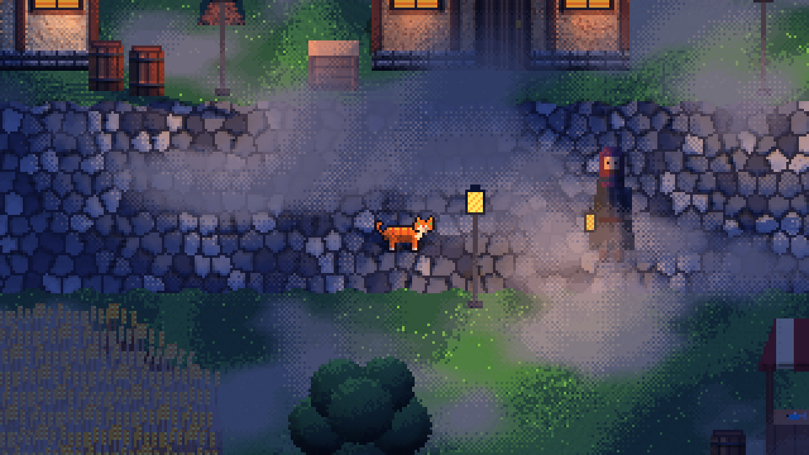
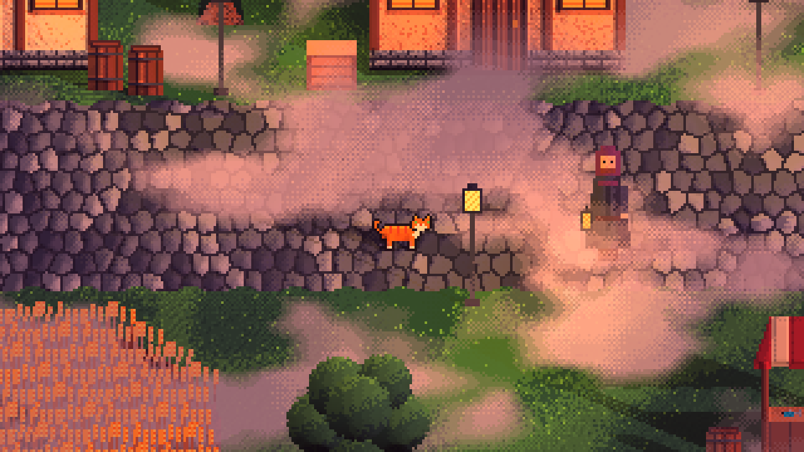

# pixelkit

A small WebGL2 engine for good-looking 2D pixel art games, built from the techniques in
[Graveyard Keeper: how the graphics effects are made](https://www.gamedeveloper.com/programming/graveyard-keeper-how-the-graphics-effects-are-made)
by Svyatoslav Cherkasov.

**[Live demo](https://pixelkit.tonysafonov.com)** · desktop browser with a keyboard, WebGL2 required

| Midnight | Dawn |
|---|---|
|  |  |

**Status:** this is an effects sandbox on one test street, not a game yet. All art is code-drawn placeholder. The planned game, Cat Burglar, is a stealth heist where these effects become the rules.

- `engine/`: the reusable platform, about 600 lines of TypeScript on raw WebGL2
- `games/cat-burglar/`: the sandbox, and later the game

Run it locally: `npm install`, then `npm run dev`, and open http://127.0.0.1:8767/games/cat-burglar/

## Sandbox keys

`1` ambient · `2` LUT · `3` normal maps · `4` 3D light rule · `5` shadows · `6` fog · `7` wind ·
`8` palette snap (cycle) · `9` light bands · `L` mouse light · `T` run time · WASD or arrows to move.

## Pipeline

Everything renders at 320×180 and scales up by a whole number:

1. **Sprites** to albedo and normal/emissive/height targets. Wind is a whole-pixel row shift.
2. **Shadows** to one channel per light slot (r = sun or moon, gba = lamps). Each is the sprite's own silhouette, projected from its foot line in the vertex shader (the article rotates a generic sprite, which mirrors shadows falling toward the camera). An object casts at most 4: sun plus its 3 nearest lamps.
3. **Compose**: ambient, lamps with the 3D light rule, height-aware fog, LUT blend, optional palette snap.

## Decision: no strict palette by default

Snapping the final image to a 16 or 32 colour palette looked noisy and muddy under lighting, so it is off by default (key `8` shows it).
The pixel grid stays exact and light steps through bands, but the frame can hold thousands of colours.

## Known limits

- Light passes through buildings: a house casts a sprite shadow on the ground, but lamp light still reaches the far side.
- Long objects get poor shadows, the same weakness the article describes.
- The cat's lamp shadow is faint compared with the villager's.
- All art is code-drawn placeholder.

## Credits

- Techniques: the Graveyard Keeper article linked above. No code or assets from that game are used.
- Palettes: Endesga-32 and Sweetie-16, via [Lospec](https://lospec.com/palette-list).

MIT licensed.
